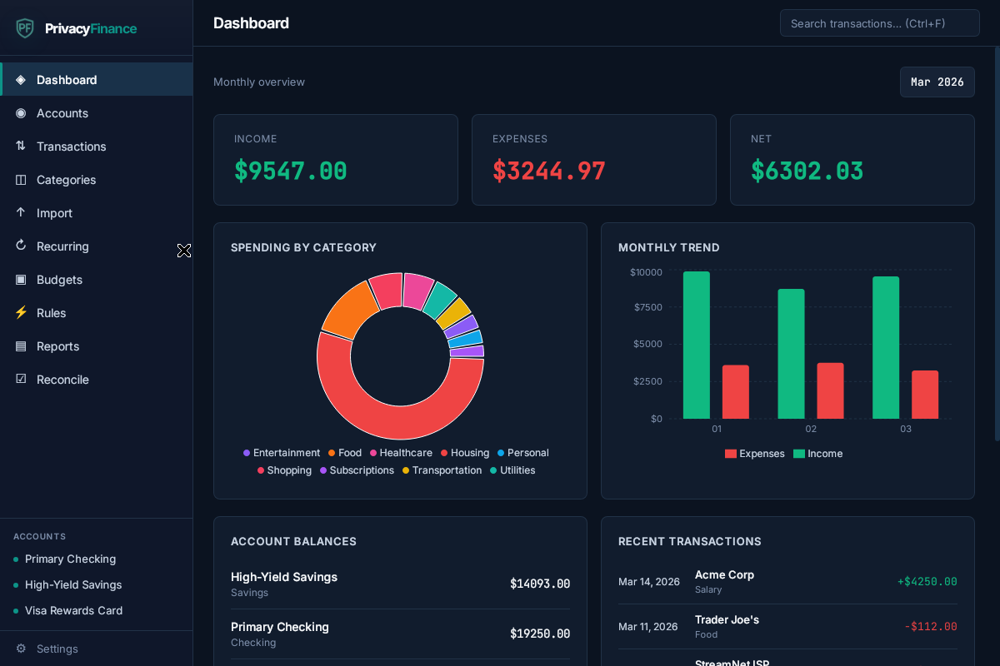

<p align="center">
  <picture>
    <source media="(prefers-color-scheme: dark)" srcset="docs/assets/logo-dark.png">
    <source media="(prefers-color-scheme: light)" srcset="docs/assets/logo-light.png">
    
  </picture>
</p>

<p align="center">
  <strong>A personal finance manager that keeps your data on your own computer.</strong>
</p>

<p align="center">
  <a href="#license"></a>
  
  
</p>

<p align="center">
  <a href="#try-it">Quickstart</a> •
  <a href="#features">Features</a> •
  <a href="#ai-search">AI search</a> •
  <a href="#privacy">Privacy</a> •
  <a href="#support">Support</a> •
  <a href="https://privacyfinance.app">Website</a>
</p>

<p align="center">
  
</p>

PrivacyFinance tracks your accounts, transactions, budgets and reports in one desktop app. Your data is
stored in a SQLite database on your computer. There are no accounts to create and no subscriptions. The
app is free.

The only optional network use is a one-time AI Search model download, which you start yourself. See
[Privacy](#privacy).

> **Status:** early. Distribution is build-from-source only for now. See [Build from source](#build-from-source).

---

## Try it

Build the app from source and run it. It opens with sample data, so you can explore before you enter
anything of your own.

```bash
git clone https://github.com/theBlackEndDev/privacy-finance.git
cd privacy-finance
npm install
npm run tauri dev
```

The first run compiles the Rust backend and takes a few minutes. Later runs are faster. The sample data
is only a starting point: [reset the database](#reset-the-data) when you want a clean start.

---

## Features

- **Accounts.** Checking, savings, credit card, cash and investment accounts, with multiple currencies.
- **Transactions.** Income, expenses and transfers between accounts, with splits across categories.
- **Categories and tags.** Color-coded categories with 15 defaults, plus free-form tags for cross-cutting groups.
- **Dashboard.** Monthly summary cards, a spending pie chart, a trend chart and account balances.
- **Budgets.** Monthly budgets per category, with rollover and undo/redo.
- **Reports.** Income and expense trends, category spending, cash flow, net worth, and tag and payee analysis.
- **CSV import.** A five-step wizard with column mapping, duplicate detection and one-click rollback. Save a
  mapping as an import profile for each bank.
- **Rules.** Categorize transactions automatically by payee, description or amount.
- **Recurring transactions.** Scheduled entries with automatic posting and control over the frequency.
- **Reconciliation.** Check an account statement against the balance in the app.
- **Export and backup.** CSV, JSON and full data export, with one-click backup and restore.
- **Search.** Full-text search across payees and descriptions, plus [AI Search](#ai-search) for questions.
- **Optional encryption.** The database can be encrypted at rest with SQLCipher and a password.
- **Themes and accessibility.** Light and dark themes, ARIA landmarks, focus management, skip links and
  keyboard shortcuts (see [Keyboard shortcuts](#keyboard-shortcuts)).

---

## AI Search

AI Search answers questions such as "how much did I spend on dining last month?" It works in three steps.
The first two run on your computer, and the app never sends the question anywhere.

1. **Templates (instant).** The app matches your question against 12 built-in intents, such as spending
   totals, spending by category, budget status, net worth and top merchants. A matching intent runs a fixed,
   known query. This step needs no model and no download.
2. **Payee fallback (instant).** If no template matches but your question names a payee, the app searches
   the payee names in your transactions and shows the matches.
3. **Local model (optional, 2 to 5 seconds).** If you installed the AI model, a small language model
   writes one SQL `SELECT` query for your question. The app then checks the SQL before it runs. It rejects
   anything that is not a single `SELECT` or `WITH` statement, and any keyword that changes data, such as
   `DROP`, `DELETE`, `INSERT`, `UPDATE`, `ATTACH` or `PRAGMA`. Results are capped at 100 rows.

If the model is not installed, the app suggests installing AI Search in Settings. The app works fully
without it.

### Installing the AI model

AI Search is off until you install it. Open **Settings** and choose **Install AI Search** in the AI Search section. This downloads
two files, and nothing is downloaded before you choose to:

- the `llama-server` program, from the latest [llama.cpp releases](https://github.com/ggml-org/llama.cpp/releases) on GitHub
- the Qwen2.5-Coder 1.5B model file (about 1 GB, Q4_K_M quantization), from [Hugging Face](https://huggingface.co/Qwen/Qwen2.5-Coder-1.5B-Instruct-GGUF)

The model file is checked against a SHA-256 checksum after the download. A file that does not match is
deleted. Once installed, the model runs on your machine. It listens only on `127.0.0.1` and uses the CPU.

---

## Privacy

- **No telemetry.** The app does not collect usage data, crash reports or analytics.
- **No accounts.** You never sign in, and there is no cloud sync.
- **Your financial data stays on your computer.** Transactions, balances and the database never leave it.
- **One optional download.** The AI model download described above is the only network request the app
  makes on purpose, and it happens only if you install AI Search.
- **Fonts load from Google Fonts.** The app's stylesheet imports the Inter and JetBrains Mono fonts from
  `fonts.googleapis.com` when it starts. This sends your IP address to Google, and it is a request the app
  makes without asking. The app works without it, but the text uses fallback fonts. Bundling the fonts into
  the app would remove this request. Until then, treat it as a network request.

---

## Build from source

PrivacyFinance is not yet published as an installer. To run a release build, build it yourself.

### Prerequisites by platform

<details>
<summary><strong>macOS</strong></summary>

**1. Xcode Command Line Tools**
```bash
xcode-select --install
```

**2. Rust**
```bash
curl --proto '=https' --tlsv1.2 -sSf https://sh.rustup.rs | sh
source "$HOME/.cargo/env"
```

**3. Node.js** (v18 or later)

Download from [nodejs.org](https://nodejs.org) or via Homebrew:
```bash
brew install node
```

**4. Verify**
```bash
rustc --version   # rustc 1.7x.x
node --version    # v18+
npm --version
```

No additional system libraries required on macOS.

</details>

<details>
<summary><strong>Linux (Ubuntu / Debian)</strong></summary>

**1. System dependencies**
```bash
sudo apt update
sudo apt install -y \
  build-essential \
  curl \
  wget \
  libssl-dev \
  libgtk-3-dev \
  libwebkit2gtk-4.1-dev \
  libayatana-appindicator3-dev \
  librsvg2-dev \
  patchelf
```

**2. Rust**
```bash
curl --proto '=https' --tlsv1.2 -sSf https://sh.rustup.rs | sh
source "$HOME/.cargo/env"
```

**3. Node.js** (v18 or later)
```bash
curl -fsSL https://deb.nodesource.com/setup_20.x | sudo -E bash -
sudo apt install -y nodejs
```

**4. Verify**
```bash
rustc --version
node --version
npm --version
```

</details>

<details>
<summary><strong>Windows</strong></summary>

**1. WebView2 Runtime**

Already installed on Windows 11. For Windows 10, download from [Microsoft](https://developer.microsoft.com/en-us/microsoft-edge/webview2/).

**2. Visual Studio Build Tools**

Download [Visual Studio Build Tools](https://visualstudio.microsoft.com/visual-cpp-build-tools/) and install the **"Desktop development with C++"** workload.

**3. Rust**

Download and run [rustup-init.exe](https://rustup.rs). Accept the defaults.

**4. Node.js** (v18 or later)

Download from [nodejs.org](https://nodejs.org) and run the installer.

**5. Verify** (in a new terminal after installation)
```powershell
rustc --version
node --version
npm --version
```

</details>

### Run in development

```bash
git clone https://github.com/theBlackEndDev/privacy-finance.git
cd privacy-finance
npm install
npm run tauri dev       # compiles the Rust backend and opens the desktop window
```

`npm run tauri dev` opens the native desktop app. `npm run dev` only serves the frontend in a browser,
which is useful for UI work but does not run the Rust backend.

If the UI does not show your latest changes, do a clean rebuild:

```bash
rm -rf dist
npm install
npm run tauri dev
```

### Build a release

```bash
npm run tauri build
```

This writes a platform installer to `src-tauri/target/release/bundle/`:

| Platform | Output         |
| -------- | -------------- |
| macOS    | `.dmg` + `.app` |
| Linux    | `.deb` + `.AppImage` |
| Windows  | `.msi` + `.exe` |

---

## Tech stack

| Layer          | Technology                                              |
| -------------- | ------------------------------------------------------- |
| Desktop shell  | Tauri 2                                                 |
| Frontend       | React 19, TypeScript, Vite 7                            |
| Backend        | Rust                                                    |
| Database       | SQLite via rusqlite, with SQLCipher (bundled)           |
| Charts         | Recharts                                                |
| CSV            | PapaParse (preview) and the Rust `csv` crate (import)   |
| Styling        | CSS Modules and CSS custom properties                   |

<details>
<summary><strong>Project structure</strong></summary>

```
src/                        # React + TypeScript frontend
├── api/                    # Tauri invoke() wrappers
├── components/             # UI components by feature
│   ├── ui/                 # Shared primitives (Button, Modal, Toast, etc.)
│   ├── accounts/
│   ├── categories/
│   ├── dashboard/
│   ├── import/
│   └── transactions/
├── context/                # React Context + useReducer state
├── hooks/                  # Custom hooks
├── styles/                 # CSS custom properties + global styles
├── types/                  # TypeScript interfaces
├── utils/                  # formatCurrency, formatDate, classNames
└── views/                  # Page-level components

src-tauri/src/              # Rust backend
├── commands/               # Tauri command handlers (including ai_search.rs)
├── db/                     # SQLite connection, migrations, seed data
├── helpers/                # AI Search pieces, timestamp utilities
├── models/                 # Rust structs (serde Serialize/Deserialize)
├── error.rs                # AppError enum
└── lib.rs                  # App setup + command registration
```

</details>

---

## Your data

### Where the database is

The database is one SQLite file. The app creates it on first launch.

| Platform | Path |
| -------- | ---- |
| macOS    | `~/Library/Application Support/com.privacyfinance.app/privacyfinance.db` |
| Linux    | `~/.local/share/com.privacyfinance.app/privacyfinance.db` |
| Windows  | `%APPDATA%\com.privacyfinance.app\privacyfinance.db` |

<details>
<summary><strong>Schema and design notes</strong></summary>

Tables: `accounts`, `categories`, `transactions`, `import_batches`, `import_profiles`, `settings`,
`recurring_transactions`, `budgets`, `budget_items`, `categorization_rules`, `tags`, `transaction_tags`,
`transaction_splits`, `reconciliations`, `reconciliation_items`, `exchange_rates`, and the `transactions_fts`
full-text index.

- Amounts are stored as integer cents. There is no floating-point money.
- Amounts are stored as positive values. The `kind` field (`income`, `expense` or `transfer`) sets the sign.
- Timestamps are UTC RFC 3339 strings.
- WAL mode is on, and foreign keys are enforced.

</details>

### Reset the data

On first launch the app creates three sample accounts, 15 categories and three months of sample
transactions. To return to that state, close the app and delete the database file. The app recreates it
on the next launch.

<details>
<summary><strong>Platform commands</strong></summary>

**macOS**
```bash
rm -f ~/Library/Application\ Support/com.privacyfinance.app/privacyfinance.db
```

**Linux**
```bash
rm -f ~/.local/share/com.privacyfinance.app/privacyfinance.db
```

**Windows (PowerShell)**
```powershell
Remove-Item "$env:APPDATA\com.privacyfinance.app\privacyfinance.db" -Force
```

**Windows (Command Prompt)**
```cmd
del /f "%APPDATA%\com.privacyfinance.app\privacyfinance.db"
```

If the file does not exist, the command does nothing.

To also remove local settings and the AI model, delete the whole app data directory. This is stronger than
deleting only the database file.

**macOS:** `rm -rf ~/Library/Application\ Support/com.privacyfinance.app`
**Linux:** `rm -rf ~/.local/share/com.privacyfinance.app`
**Windows (PowerShell):** `Remove-Item "$env:APPDATA\com.privacyfinance.app" -Recurse -Force`

</details>

---

## Keyboard shortcuts

| Shortcut | Action |
| -------- | ------ |
| `Ctrl+1` | Dashboard |
| `Ctrl+2` | Accounts |
| `Ctrl+3` | Transactions |
| `Ctrl+4` | Categories |
| `Ctrl+5` | Import |
| `Ctrl+6` | Recurring |
| `Ctrl+7` | Budgets |
| `Ctrl+8` | Rules |
| `Ctrl+9` | Reports |
| `Ctrl+B` | Budgets (alternate) |
| `Ctrl+N` | Focus the new-transaction form |
| `Ctrl+F` | Focus search |
| `Ctrl+?` | Show this list |
| `Esc` | Close a dialog or clear search |

On macOS these shortcuts use the Command key (`⌘`) as well as `Ctrl`.

---

## Tests

### Rust unit tests

```bash
cd src-tauri
cargo test
```

The suite has 156 `#[test]` functions in 19 files. Counted with
`grep -r "#\[test\]" src-tauri/src src-tauri/tests`. They cover migrations, CRUD for accounts, categories
and transactions, transfers, dashboard totals, CSV import, encryption, reports, rules, and the AI Search
templates and SQL validator.

### Frontend unit tests (Vitest)

```bash
npm test
```

Five test files with 25 test cases, for hooks and formatting utilities.

### End-to-end tests (WebdriverIO and Tauri)

End-to-end tests drive the real desktop app through [WebdriverIO](https://webdriver.io/) and
[tauri-webdriver](https://github.com/Choochmeque/tauri-webdriver). The suite has 18 spec files with 92
test cases, in `e2e/specs/`. Counted with `grep -cE "^\s*it\(" e2e/specs/*.ts`.

Prerequisites: run `npm install`, then install the WebDriver CLI once with
`cargo install tauri-webdriver --locked`.

```bash
npm run test:e2e        # build the app with the e2e feature, then run all specs
npm run test:e2e:only   # run the specs against an already-built app
```

The build step embeds a WebDriver server in the app on port 4445. `tauri-webdriver` listens on 4444 and
forwards commands to it. Each spec starts from a reset database.

<details>
<summary><strong>Troubleshooting</strong></summary>

- **`wdio: command not found`.** Run `npm install`. The `wdio` binary comes from `@wdio/cli`.
- **`tauri-webdriver: command not found`.** Run `cargo install tauri-webdriver --locked`.
- **The app does not launch.** Build it first with `npm run test:e2e:build`. The `e2e` feature is required.
- **Tests time out.** The default timeout is 60 seconds per test. Check that the binary exists under
  `src-tauri/target/`.

</details>

---

## Support

PrivacyFinance is free, and there is no paid tier.

- **Donate.** If the app is useful to you, you can support its development on
  [Buy Me a Coffee](https://buymeacoffee.com/theblackenddev).
- **Paid setup help.** For a custom install, help with setup, or changes for your environment, email
  [hello@privacyfinance.app](mailto:hello@privacyfinance.app).
- **Website.** [privacyfinance.app](https://privacyfinance.app)

---

## License

PrivacyFinance is licensed under the GNU General Public License v3.0 (GPL-3.0). In plain terms, you can use,
study, change and share the code. If you distribute a modified version, you must also share its source
code under the same license.

See [LICENSE](LICENSE) for the full text.
